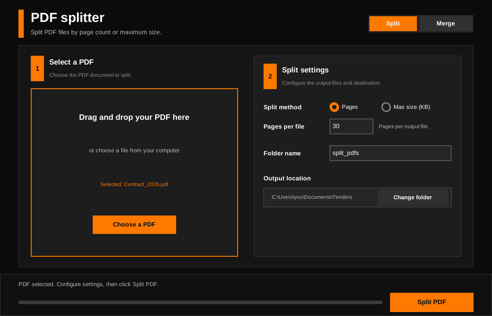
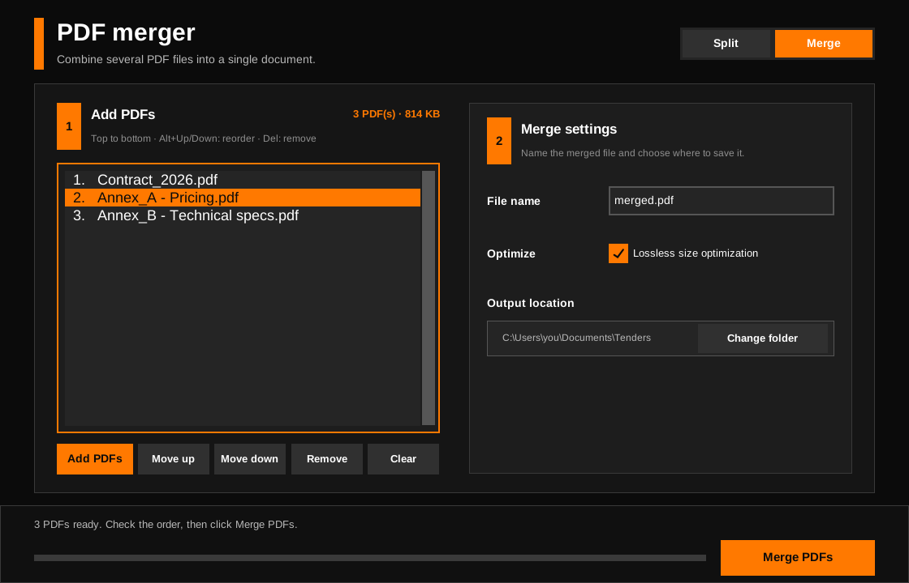

# PDFTools


A simple desktop app to split and merge PDF files. Drag and drop your documents, choose how you want them cut or combined, and click one button. The interface is built with CustomTkinter, and the PDF work is done by qpdf, so pages are never re-rendered: text, images and quality stay exactly the same.

## ✨ Features

- **Split by Pages**: Cut a PDF into files with a fixed number of pages (e.g. one file every 30 pages).
- **Split by Size**: Cut a PDF into files that stay under a maximum size in KB, perfect for email or upload limits.
- **Merge PDFs**: Combine several PDFs into one, in the order you choose (Move up / Move down, or `Alt + ↑ / ↓`).
- **Drag and Drop**: Drop files, or a whole folder, directly into the app.
- **Lossless Optimization**: Reduces file size without touching image quality.

## 📋 Requirements

- **Python 3.x**: Ensure you have Python installed. You can download it from the [official website](https://www.python.org/).
- **qpdf**: The PDF engine used by the app. Install it with `winget install qpdf` or from the [qpdf releases](https://github.com/qpdf/qpdf/releases).
- **CustomTkinter and tkinterdnd2**: Used for the interface and drag and drop.

## 🛠️ Installation

1. **Clone this repository**:
    ```bash
    git clone https://github.com/darrengls/PDFTools
    cd PDFTools
    ```

2. **Install the required libraries**:
    ```bash
    pip install -r requirements.txt
    ```

3. **Run the program**:
    ```bash
    python pdf_tools.py
    ```

## 📦 Build the .exe

1. **Create a `qpdf_bin` folder** next to `pdf_tools.py` and copy everything from `C:\Program Files\qpdf X.Y.Z\bin\` into it (`qpdf.exe` and all the `.dll` files).

2. **Run the build script**:
    ```bash
    build_exe.bat
    ```

3. **Get your app** in `dist\PDF Tools.exe`. It works on any Windows PC, without Python or qpdf installed.

## 📂 Project Structure

- `pdf_tools.py`: The main Python script that runs the app.
- `requirements.txt`: The Python libraries needed by the project.
- `build_exe.bat`: Script that builds the Windows executable.
- `README.md`: Instructions and documentation for the project.

## 📖 How It Works

1. **Split**: The PDF is cut into page ranges with qpdf. In size mode, the app searches for the biggest range of pages that stays under the maximum size.
2. **Merge**: Each file is checked first, then qpdf combines them in the order shown in the list.
3. **Optimization**: The PDF structure is rebuilt and compressed without recompressing images, so the quality is preserved.

## ⚡ Technologies Used

- **Python**: The programming language used for this project.
- **CustomTkinter**: A library that provides modern-looking widgets for Tkinter.
- **qpdf**: A command-line tool for fast and lossless PDF manipulation.
- **PyInstaller**: A tool that packages the app into a standalone Windows executable.

## 📸 Screenshot



## 🔗 License

This project is open-source and available under the MIT License. Feel free to fork, modify, and use it in your projects.

---

Enjoy splitting and merging your PDFs in just a few clicks!


